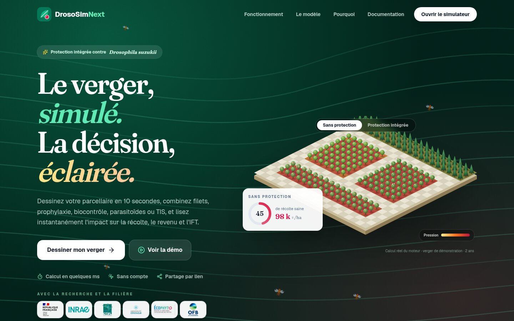
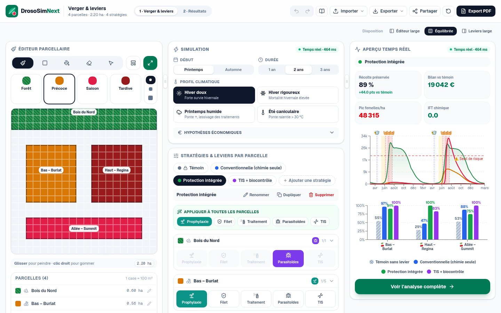
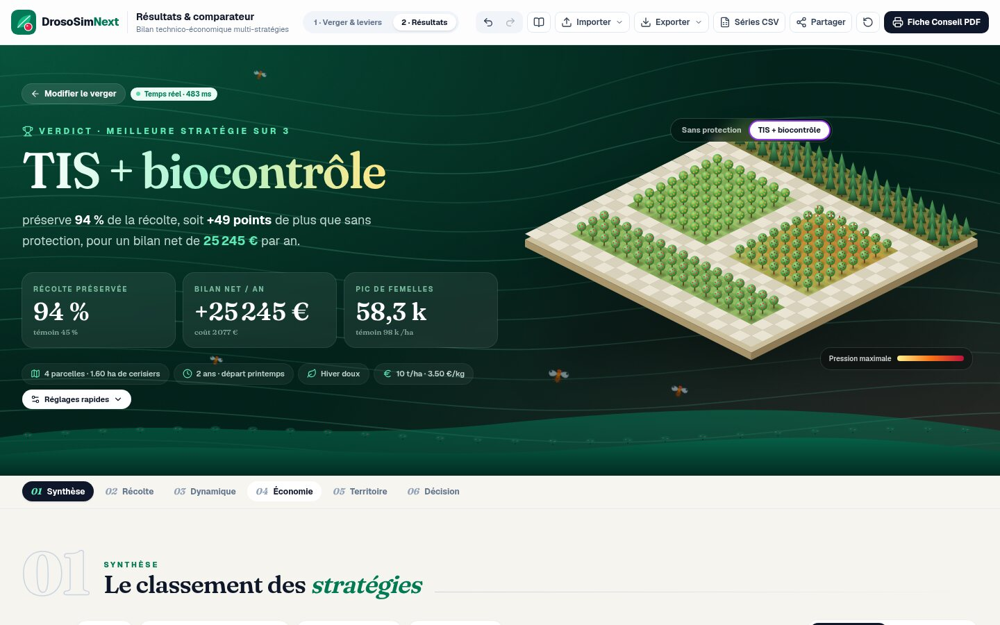
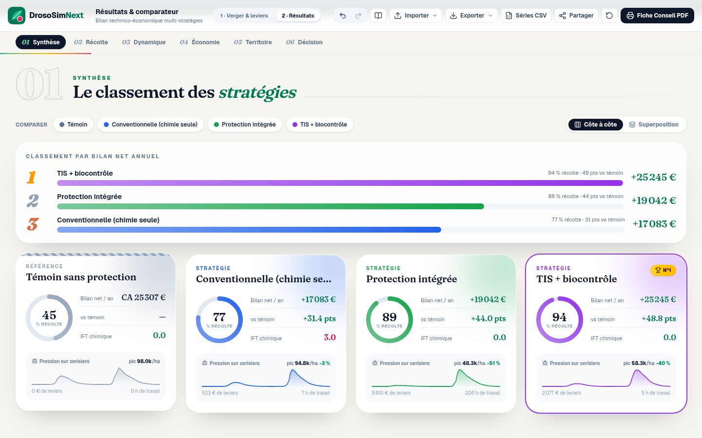
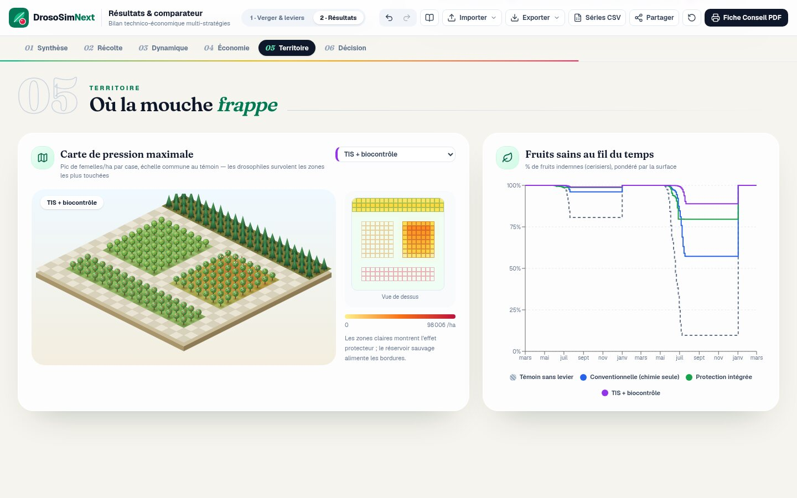
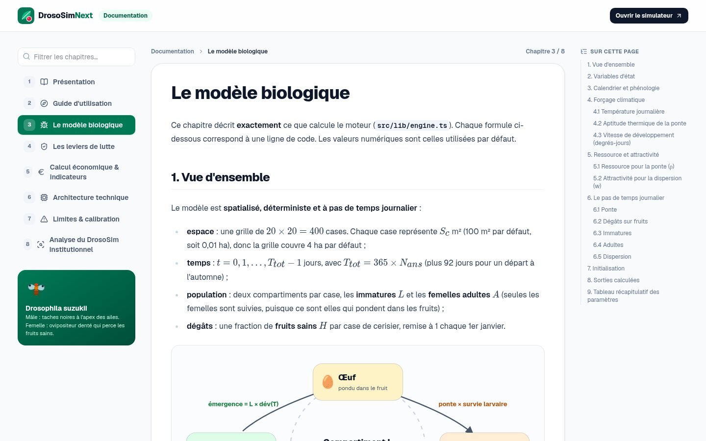
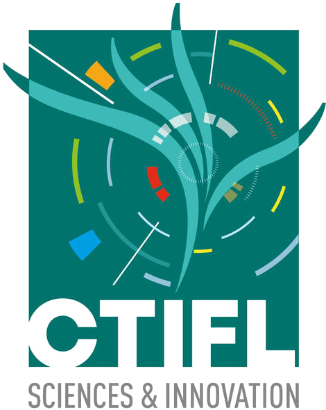
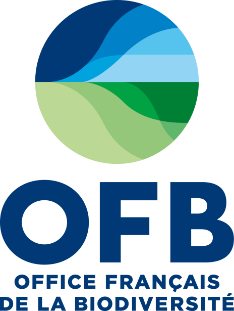

<p align="center">
  
</p>

<p align="center">
  
  
  
  
  
  
</p>

<p align="center">
  <b>Simulateur d'aide à la décision pour la protection intégrée des vergers de cerisiers contre <i>Drosophila suzukii</i>.</b><br>
  Dessinez votre verger, combinez les leviers de lutte, comparez les stratégies — en temps réel, dans le navigateur.
</p>

<p align="center">
  
  <br><sub>Parcours complet en 25 secondes · <a href="docs/assets/demo.mp4">version vidéo MP4</a></sub>
</p>

---

## Sommaire

- [Fonctionnalités](#-fonctionnalités)
- [Démarrage rapide](#-démarrage-rapide)
- [Aperçu](#-aperçu)
- [Sauvegarder et partager](#-sauvegarder-et-partager)
- [Brancher son backend de simulation](#-brancher-son-backend-de-simulation)
- [Modifier le code](#-modifier-le-code)
- [Documentation complète](#-documentation-complète)
- [Déployer](#-déployer)
- [Le modèle et ses limites](#-le-modèle-et-ses-limites)
- [Partenaires](#-partenaires)

## ✨ Fonctionnalités

| | |
|---|---|
| 🖌️ **Éditeur de verger 20 × 20** | pinceau 1×1 à 3×3, zone rectangulaire, remplissage, gomme au clic droit, modèles prêts à l'emploi, plein écran, colonnes redimensionnables, historique Ctrl+Z / Ctrl+Y |
| 🌳 **Parcelles automatiques** | les cases contiguës forment des parcelles nommées, renommables, avec leur surface |
| 🛡️ **5 leviers par parcelle** | filet insect-proof, prophylaxie, traitements chimiques ou de biocontrôle, parasitoïdes, TIS, avec des réglages fins et « Appliquer à toutes » |
| ⚡ **Calcul en temps réel** | moteur spatio-temporel journalier, environ 20 ms par stratégie sur 3 ans, relancé à chaque modification |
| 🌦️ **Climat & durée** | départ printemps ou automne, 1 à 3 ans, 4 profils climatiques |
| 🏆 **Résultats « décision »** | verdict, podium, cartes animées, 8 graphiques légendés (phénologie, interventions), carte de pression en 3D isométrique |
| 💶 **Économie** | chiffre d'affaires sauvé, coûts détaillés et modifiables, bilan net, ROI, IFT, heures de travail, radar multicritère |
| 💾 **Import / export universel** | JSON, `.drososim`, image PNG, CSV, lien : tous rechargeables, y compris par glisser-déposer |
| 🔌 **Backend interchangeable** | branchez votre propre modèle (Python, R, Rust…) en HTTP ou WebSocket |
| 📚 **Documentation intégrée** | 10 chapitres en français sur `/docs` : équations, leviers, économie, architecture, backend |

## 🚀 Démarrage rapide

**Prérequis** : [Node.js](https://nodejs.org) ≥ 20 (22+ recommandé) et npm.

```bash
# 1. Installer
git clone https://github.com/RemiPelloux/DrosoSimBetter.git
cd DrosoSimBetter
npm install

# 2. Lancer en développement (rechargement à chaud)
npm run dev
# → http://localhost:3000
```

Cliquez sur **« Voir la démo »** pour charger un verger d'exemple avec trois stratégies.

<details>
<summary><b>Toutes les commandes</b></summary>

| Commande | Rôle |
|---|---|
| `npm run dev` | serveur de développement sur le port 3000 |
| `npm run build` | build de production |
| `npm start` | sert le build de production |
| `npm run lint` | ESLint |
| `npx tsc --noEmit` | vérification des types |
| `npm run test:engine` | contrôle du moteur (48 scénarios) |
| `npm run test:e2e` | parcours navigateur Playwright (nécessite `npm start -- -p 3100` et Chromium) |
| `node examples/backend-node/server.ts` | backend de référence sur le port 8787 |
| `python3 examples/backend-python/server.py` | squelette de backend Python sur le port 8788 |

</details>

### Raccourcis clavier

`B` `R` `F` `E` `V` outils · `1`–`4` types de case · `[` `]` taille du pinceau · `Maj+F` éditeur plein écran · `Ctrl+Z` / `Ctrl+Y` annuler / rétablir · `Ctrl+S` sauvegarder · `Échap` fermer

## 🖼️ Aperçu

<table>
  <tr>
    <td width="50%"><br><sub><b>Accueil</b> : verger isométrique calculé en direct par le moteur</sub></td>
    <td width="50%"><br><sub><b>Simulateur</b> : éditeur, paramètres, leviers et aperçu temps réel</sub></td>
  </tr>
  <tr>
    <td><br><sub><b>Résultats</b> : verdict, chiffres clés, bascule témoin / gagnante</sub></td>
    <td><br><sub><b>Synthèse</b> : podium par bilan net et cartes de stratégie</sub></td>
  </tr>
  <tr>
    <td><br><sub><b>Territoire</b> : carte de pression et fruits sains</sub></td>
    <td><br><sub><b>Documentation</b> : équations rendues et schémas animés</sub></td>
  </tr>
</table>

## 💾 Sauvegarder et partager

Chaque format exporté contient **le projet complet** et se recharge via **Importer** ou par **glisser-déposer** n'importe où dans l'application.

| Format | Usage |
|---|---|
| **JSON** (`Ctrl+S`) | format complet et lisible |
| **`.drososim`** | format compact compressé |
| **Image PNG** | plan du verger ; le projet est caché dans l'image |
| **CSV** | grille et leviers lisibles dans Excel |
| **Lien** (`.txt` ou bouton *Partager*) | `…/simulator?sim=…`, sans compte ni serveur |
| **Grille saisie à la main** | 20 × 20 cases dans un tableur (`F`/`P`/`S`/`T`/`.` ou `forêt`, `précoce`, …) |
| **Fiche Conseil PDF** | rapport A4 imprimable (non rechargeable) |

## 🔌 Brancher son backend de simulation

L'interface est **découplée du calcul**. Par défaut, le moteur TypeScript tourne dans un Web Worker, mais une équipe de recherche peut brancher **son propre modèle** sans toucher à l'interface.

<p align="center"></p>

**1. Lancer un backend d'exemple**

```bash
python3 examples/backend-python/server.py     # squelette à compléter (aucune dépendance)
# ou
node examples/backend-node/server.ts          # le moteur de l'application derrière HTTP
```

**2. Le brancher**, à chaud :

```
http://localhost:3000/simulator?backend=http://localhost:8788/simulate
```

ou de façon permanente, dans `.env.local` :

```bash
NEXT_PUBLIC_SIM_BACKEND=http                 # local | http | ws
NEXT_PUBLIC_SIM_BACKEND_URL=https://api.mon-labo.fr/simulate
```

**3. Implémenter le contrat.** Votre serveur reçoit le verger, les parcelles, les stratégies et les paramètres, puis renvoie au minimum le pourcentage de récolte saine par parcelle :

```json
{ "results": [
  { "id": "baseline",   "harvestByParcel": { "late-cherry-1": 46.2 } },
  { "id": "strategy-a", "harvestByParcel": { "late-cherry-1": 98.7 } }
] }
```

L'application complète le reste (récolte globale, chiffre d'affaires, phénologie). Si le backend tombe, elle **bascule automatiquement sur le moteur local** et le signale par un badge orange.

➡️ Contrat complet, protocole WebSocket, version FastAPI et adaptateur pour un modèle de type DrosoSim INRAE : **[docs/09-backend.md](docs/09-backend.md)**

## 🛠️ Modifier le code

Structure du dépôt — tout est à la racine :

```
DrosoSimBetter/
├── src/
│   ├── app/                    pages Next.js
│   │   ├── page.tsx            accueil (landing)
│   │   ├── simulator/          cockpit : éditeur, leviers, aperçu temps réel
│   │   ├── results/            résultats, comparateur, Fiche Conseil
│   │   ├── docs/               documentation intégrée (/docs)
│   │   └── docs-assets/        médias de docs/assets servis à l'application
│   ├── components/             éditeur, leviers, graphiques, illustrations SVG
│   └── lib/
│       ├── engine.ts           ⭐ modèle biologique, leviers, économie (pur, sans dépendance)
│       ├── backend.ts          contrat et backends (local, HTTP, WebSocket)
│       ├── store.ts            état, historique, persistance, partage
│       ├── projectIO.ts        import / export universel
│       └── useSimulation.ts    calcul temps réel
├── docs/                       documentation en Markdown (rendue sur /docs)
│   └── assets/                 bannière, schémas animés, démo GIF/MP4, captures
├── examples/
│   ├── backend-node/           backend de référence (moteur derrière HTTP)
│   └── backend-python/         squelette Python sans dépendance
├── public/partners/            logos des partenaires
├── scripts/                    tests du moteur et parcours navigateur
├── package.json                dépendances et commandes npm
├── next.config.ts · tsconfig.json · eslint.config.mjs
└── README.md
```

Recettes pas à pas dans **[docs/10-developpement.md](docs/10-developpement.md)** :
- changer un paramètre biologique ou les dates de maturité ;
- ajouter un levier, un type de case, un graphique, un modèle de verger ou un format d'export ;
- conventions de code et déploiement.

## 📚 Documentation complète

Disponible dans l'application sur **`/docs`** (formules KaTeX, schémas animés) et en Markdown :

| # | Chapitre | |
|---|---|---|
| 1 | [Présentation](docs/01-presentation.md) | objectifs, personas |
| 2 | [Guide d'utilisation](docs/02-guide.md) | outils, résultats, exports, raccourcis |
| 3 | [Le modèle biologique](docs/03-modele.md) | variables, équations, paramètres |
| 4 | [Les leviers de lutte](docs/04-leviers.md) | formalisation de chaque levier |
| 5 | [Économie & indicateurs](docs/05-economie.md) | CA, coûts, bilan, IFT, radar |
| 6 | [Architecture technique](docs/06-architecture.md) | pile, moteur, état, formats |
| 7 | [Limites & calibration](docs/07-limites.md) | hypothèses, démarche de calibration |
| 8 | [Analyse du DrosoSim institutionnel](docs/08-drososim-institutionnel.md) | modèle de drososim.fr |
| 9 | [Brancher son backend](docs/09-backend.md) | contrat, HTTP, WebSocket, exemples |
| 10 | [Modifier le code](docs/10-developpement.md) | recettes, conventions, déploiement |

## ☁️ Déployer

```bash
npm ci && npm run build && npm start          # Node, port 3000
```

- **Vercel / Netlify** : importer le dépôt tel quel, aucune configuration particulière.
- **VPS** : derrière Caddy ou Nginx (HTTPS, HTTP/3, compression) ; voir [docs/10-developpement.md](docs/10-developpement.md#5-déployer).
- Aucune base de données : les projets restent dans le navigateur ou dans les fichiers exportés.

## 🔬 Le modèle et ses limites

Le moteur intégré est un **modèle spatio-temporel journalier** sur une grille de 400 cases : température, ponte selon la maturité des fruits, développement en degrés-jours, mortalité, dispersion vers les vergers attractifs. Chaque stratégie est simulée intégralement.

> ⚠️ **Modèle pédagogique, non calibré sur des données de terrain.** Il sert à **comparer des stratégies** et à comprendre les mécanismes, pas à prédire un rendement. Les équipes de recherche peuvent y substituer leur modèle validé via le [backend](#-brancher-son-backend-de-simulation). Voir [Limites & calibration](docs/07-limites.md).

## 🤝 Partenaires

<p align="center">
  &nbsp;&nbsp;&nbsp;
  &nbsp;&nbsp;&nbsp;
  &nbsp;&nbsp;&nbsp;
  &nbsp;&nbsp;&nbsp;
  &nbsp;&nbsp;&nbsp;
  
</p>

<p align="center"><sub>DrosoSim est porté par l'équipe M2P2 de l'INRAE Sophia Antipolis, avec le CTIFL, l'Université Côte d'Azur, le plan Écophyto et l'OFB.<br>Les logos sont la propriété de leurs institutions respectives.</sub></p>
